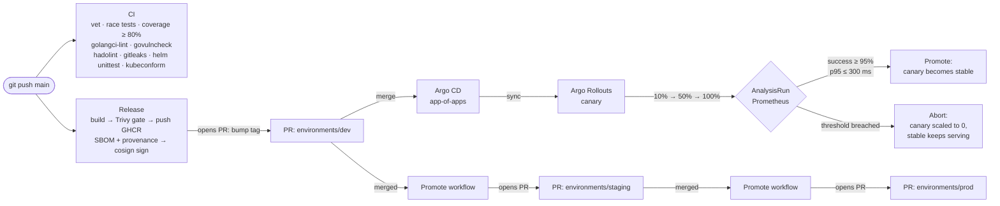

# k8s-progressive-delivery

[](https://github.com/ahmedelgmal310/k8s-progressive-delivery/actions/workflows/ci.yml)
[](https://github.com/ahmedelgmal310/k8s-progressive-delivery/actions/workflows/release.yml)
[](LICENSE)

Progressive delivery on Kubernetes with **automated rollback**. A Go service ships
as an **Argo Rollouts** canary. **Prometheus** analysis gates each step on the canary's own
success rate and p95 latency. Promotion runs **GitOps**-style through **Argo CD** and pull
requests (dev → staging → prod).

Every push to `main` re-proves the core claim on a throwaway **kind** cluster under
**k6** load: a good release is promoted all the way, and a bad release is caught by
analysis and **rolled back automatically**. If the rollback does not happen, the job fails.

## Contents

- [How it works](#how-it-works)
- [Canary strategy](#canary-strategy)
- [Analysis queries](#analysis-queries)
- [Traffic shaping: why a replica-based canary](#traffic-shaping-why-a-replica-based-canary)
- [Results from CI](#results-from-ci)
- [GitOps and promotion](#gitops-and-promotion)
- [Supply chain and quality gates](#supply-chain-and-quality-gates)
- [Runbook](#runbook)
- [Repository layout](#repository-layout)
- [Local development](#local-development)

## How it works



**The service** ([`cmd/demo-api`](cmd/demo-api), [`internal/server`](internal/server)) is
Go stdlib plus the Prometheus client. It exposes:

| Endpoint | Purpose |
|---|---|
| `GET /` | Business endpoint, returns `{service, version, pod}` |
| `GET /healthz` | Liveness, readiness and startup probe target |
| `GET /metrics` | `http_requests_total{route,method,code}`, `http_request_duration_seconds{route,code}` histogram, `demo_api_build_info{version}` and Go runtime metrics |

**Fault injection** makes a "bad" release reproducible. The fault defaults are baked in at
build time, so a bad release is a separate, immutable image tag:

```sh
docker build --build-arg VERSION=v3 --build-arg FAULT_ERROR_RATE=0.3 -t demo-api:v3 .
```

The same faults can be overridden at runtime for game days with `FAULT_ERROR_RATE`
(0 to 1, the fraction of `/` requests answered with HTTP 500) and `FAULT_LATENCY_MS`.
In Helm, set them with `fault.errorRate` and `fault.latencyMs`. `/healthz` stays green
even when the service is faulty. This is deliberate: probes alone cannot catch a bad
release, and the metric analysis can.

**The Helm chart** ([`charts/demo-api`](charts/demo-api)) renders a `Rollout`, an
`AnalysisTemplate`, a `Service`, a `ServiceAccount` (no token automount), a `PodDisruptionBudget`,
an optional `HorizontalPodAutoscaler` that targets the Rollout, a default-deny
`NetworkPolicy` (ingress only from allowed namespaces on the http port, egress only to DNS),
and an optional `Ingress`. Pods run as non-root (UID 65532) on distroless with a read-only
root filesystem, all capabilities dropped, a `RuntimeDefault` seccomp profile and a native
`preStop` sleep for graceful endpoint removal. The chart is checked with `helm lint --strict`
for every environment, helm-unittest ([`charts/demo-api/tests`](charts/demo-api/tests)) and
`kubeconform -strict`, including the Argo CRD schemas.

## Canary strategy

Steps come from `rollout.canary.steps` in values. Each entry expands to `setWeight`, an
optional `pause`, and an optional inline `analysis` step that blocks until the analysis
finishes. After the last step, the canary is promoted to 100%.

```mermaid
stateDiagram-v2
  direction LR
  [*] --> W10: new image tag
  W10: setWeight 10%
  P1: pause 30s
  A1: analysis (4 × 15s)
  W50: setWeight 50%
  P2: pause 30s
  A2: analysis (4 × 15s)
  Full: 100% — canary becomes stable
  Aborted: abort — canary scaled to 0, stable untouched
  W10 --> P1 --> A1
  A1 --> W50: pass
  A1 --> Aborted: fail
  W50 --> P2 --> A2
  A2 --> Full: pass
  A2 --> Aborted: fail
```

| Environment | Steps | Analysis | Thresholds |
|---|---|---|---|
| e2e (kind) | 10% → pause 30s → analysis → 50% → pause 30s → analysis → 100% | 4 measurements, 15s apart | success ≥ 95%, p95 ≤ 300 ms |
| dev | 50% → pause 30s → analysis → 100% | 3 × 20s | success ≥ 95%, p95 ≤ 300 ms |
| staging | 10% → 30s → analysis → 50% → 30s → analysis → 100% | 4 × 20s | success ≥ 95%, p95 ≤ 300 ms |
| prod | 10% → 2m → analysis → 25% → 2m → analysis → 50% → 5m → analysis → 100%, HPA 10–30 | 6 × 30s | success ≥ 99%, p95 ≤ 250 ms |

`failureLimit: 1` tolerates one noisy sample, so a second failed measurement aborts the
rollout. `progressDeadlineAbort: true` also aborts a rollout that stops making progress,
for example when canary pods never become ready.

## Analysis queries

Both metrics are scoped to the **canary pods only** with the pod-template hash that Argo
Rollouts injects (`podTemplateHashValue: Latest`). Prometheus keeps the pod label as
`rollouts_pod_template_hash`, so the stable pods' healthy traffic cannot dilute a bad canary.

**Success rate** passes when `result[0] >= 0.95`:

```promql
sum(rate(http_requests_total{namespace="{{args.namespace}}",rollouts_pod_template_hash="{{args.canary-hash}}",route="/",code!~"5.."}[1m]))
/
sum(rate(http_requests_total{namespace="{{args.namespace}}",rollouts_pod_template_hash="{{args.canary-hash}}",route="/"}[1m]))
```

**p95 latency** passes when `result[0] <= 0.3` seconds:

```promql
histogram_quantile(0.95,
  sum by (le) (rate(http_request_duration_seconds_bucket{namespace="{{args.namespace}}",rollouts_pod_template_hash="{{args.canary-hash}}",route="/"}[1m])))
```

A `NaN` result (for example `0/0`) counts as a failure, not a pass. An empty result is
inconclusive, so the rollout pauses for a human instead of guessing. The histogram buckets
include `0.3` exactly, so the p95 threshold falls on a bucket boundary rather than on an
interpolated value.

## Traffic shaping: why a replica-based canary

The canary is **replica-based**: one `Service` selects both stable and canary pods, and the
traffic share follows the pod ratio. With 10 replicas, `setWeight: 10` means exactly one
canary pod. I chose this deliberately for the CI proof:

- **Deterministic on kind.** There is no ingress controller, traffic-router plugin or
  `LoadBalancer` to install and wait on. Fewer moving parts make a more trustworthy signal.
- **The analysis does not depend on the split.** The queries filter on the canary's pod hash,
  so the success rate measures the canary alone at any weight.
- **Even balancing.** The k6 load generator sets `noConnectionReuse`, so kube-proxy balances
  every request. The canary's share of traffic then matches its share of pods. With
  keep-alive, a few long-lived connections could miss the canary entirely.

The trade-off is weight granularity, since a weight maps to whole pods. In production, where
1% steps or header-based routing matter, switch the Rollout to
`trafficRouting.nginx` (ingress-nginx), Gateway API or a service mesh. You would add
`canaryService`/`stableService`. The analysis template, steps and promotion flow stay the same.

## Results from CI

These numbers come from CI run
[#40447125551](https://github.com/ahmedelgmal310/k8s-progressive-delivery/actions/runs/40447125551)
on `main`: kind v0.33.0, Kubernetes v1.36.4, Argo Rollouts v1.10.0, Prometheus v3.15.0 (10s
scrape) and k6 at a constant ~40 req/s. Each run uploads its own numbers as the
`e2e-results` artifact and posts them in the job summary.

| Scenario | Measured |
|---|---|
| **v2 (good)**: time from `helm upgrade` to 100% promoted | **164 s** (10% → 50% → 100%, 2 analysis steps) |
| v2 canary success rate (8 measurements) | 1.00 on every measurement |
| v2 canary p95 latency (8 measurements) | 4.75 ms on every measurement (threshold 300 ms) |
| **v3 (bad, 30% injected HTTP 500)**: time to automatic abort | **49 s** after `helm upgrade` (canary at 10%, 1 of 10 pods) |
| v3: time until all traffic is back on v2 (canary pods gone, 10/10 stable ready) | **56 s** |
| v3 canary success rate that failed analysis | 0.724, then 0.757: **27.6% and 24.3% errors**, threshold 5% |
| Failure reason (AnalysisRun `demo-api-575cbd77cf-3-2`) | `Metric "success-rate" assessed Failed due to failed (2) > failureLimit (1)` |
| 5xx rate on the service 45 s after the rollback | **0 req/s** (of ~40 req/s) |

Only 1 of 10 pods ran the bad version, and only for under a minute. Users therefore saw
roughly 10% × 27% ≈ 3% errors during that window, and none afterwards.

What `e2e/run.sh` asserts (any failure fails the job):

1. v1 deploys and becomes `Healthy`, and Prometheus is scraping it under load.
2. v2's new ReplicaSet becomes `stableRS` and the rollout is `Healthy` within 10 minutes.
3. v3 never becomes stable. The rollout aborts (`status.abort=true`, phase `Degraded`),
   `stableRS` is still v2, no v3 pod is left, and all 10 v2 pods are ready.
4. A failed `AnalysisRun` exists for v3, and its success-rate measurements are recorded.
5. After the rollback, Prometheus shows zero 5xx responses.

## GitOps and promotion

```
gitops/
  bootstrap/root-app.yaml      # app-of-apps root: apply once per Argo CD instance
  apps/project.yaml            # AppProject: allowed repo, namespaces, resource kinds
  apps/demo-api-{dev,staging,prod}.yaml   # one Application per environment
environments/{dev,staging,prod}/values.yaml  # the only files promotions change
```

Each environment's `Application` renders `charts/demo-api` with
`environments/<env>/values.yaml`. Automated sync, prune and self-heal are on, so **merging
a PR is the deployment**. Argo CD understands `Rollout` health natively. An aborted rollout
shows as `Degraded` until git is fixed.

Promotion is a chain of pull requests that bump `image.tag`:

1. **Release** ([`release.yml`](.github/workflows/release.yml)) runs on service changes to
   `main`. It builds the image, gates it on Trivy, pushes `ghcr.io/ahmedelgmal310/demo-api:sha-<commit>`
   with SBOM and provenance attestations, and signs it with cosign (keyless OIDC). It then
   opens a PR that bumps `environments/dev`.
2. **Promote** ([`promote.yml`](.github/workflows/promote.yml)) runs when a dev or staging
   bump lands on `main` and opens the next PR (dev → staging, staging → prod) with the same
   tag. It can also be dispatched by hand for any tag and environment.
3. [`scripts/promote.sh`](scripts/promote.sh) does the actual change. It is idempotent: it
   does nothing when the environment already runs the tag or the PR already exists.

Promotion PRs are opened with the workflow's `GITHUB_TOKEN`. In an organization I would use a
GitHub App token so required checks run on bot PRs, and protect `environments/prod/**` with
CODEOWNERS review. The promote job would also wait for the source environment's Argo CD
application to report `Healthy` before opening the next PR.

## Supply chain and quality gates

| Gate | Where | Fails the build when |
|---|---|---|
| `go vet`, `go test -race` | CI `go` | vet finding or failing or racy test |
| Coverage | CI `go` | total statement coverage < 80% |
| govulncheck | CI `go` | a reachable known vulnerability |
| golangci-lint v2 (gosec, errorlint, revive, contextcheck, ...) | CI `golangci-lint` | any finding |
| hadolint | CI `static` | Dockerfile warning or error |
| Gitleaks (full history) | CI `static` | secret detected |
| shellcheck | CI `static` | shell script issue |
| helm lint `--strict` (all envs), helm-unittest, kubeconform `-strict` | CI `helm` | template, test or schema error |
| Trivy (HIGH/CRITICAL, fixed) | CI `image`, Release | fixable HIGH/CRITICAL vulnerability |
| kind e2e | CI `e2e` | good release not promoted, **or bad release not rolled back** |

Other supply-chain controls:

- Every action is pinned to a full commit SHA with a version comment. Base and tool images
  are pinned by digest (`golang`, `distroless/static-debian13:nonroot`, Trivy, hadolint,
  Gitleaks, k6, kind node).
- Docker Hub pulls go through `mirror.gcr.io` (buildkit mirror config), which avoids
  rate limits on shared runners.
- Workflows default to `contents: read`. Only the jobs that need them get `packages: write`,
  `id-token: write` or `pull-requests: write`.
- Dependabot covers Go modules, actions and the Dockerfile with a 14-day cooldown.
- The SBOM (CycloneDX) is uploaded on every CI run and attached to every pushed image.

## Runbook

All commands assume `NS=demo-api-prod` (or the namespace in question) and the
[`kubectl argo rollouts`](https://argo-rollouts.readthedocs.io/en/stable/installation/#kubectl-plugin-installation) plugin.

**Watch a rollout**

```sh
kubectl argo rollouts get rollout demo-api -n "$NS" --watch
kubectl get analysisrun -n "$NS"                     # one per analysis step
kubectl describe analysisrun <name> -n "$NS"         # measured values per metric
```

**Abort manually** (canary looks wrong before the analysis catches it):

```sh
kubectl argo rollouts abort demo-api -n "$NS"
```

The canary scales to 0 and the stable ReplicaSet serves 100% of traffic. Then fix git:
revert the promotion commit, or open a PR that sets the previous tag. Argo CD then
reconciles the desired state back to the stable version, and the rollout returns to `Healthy`.

**Promote manually**

```sh
kubectl argo rollouts promote demo-api -n "$NS"          # skip the current pause/step
kubectl argo rollouts promote demo-api -n "$NS" --full   # skip all remaining steps (emergency only)
```

**After an automatic abort**, the rollout is `Degraded` and the previous version is still
serving. Do not retry blindly:

1. Read the failed `AnalysisRun` (`kubectl describe analysisrun ...`) to see which metric
   failed and the measured values.
2. Revert the promotion commit in git. This is the source of truth. Use
   `kubectl argo rollouts retry rollout demo-api -n "$NS"` only if the failure was
   environmental and the same image should run again.

**Inconclusive analysis** (no data, for example no traffic): the rollout pauses. Check the
Prometheus targets and traffic, then `promote` or `abort` explicitly.

**Game day**: inject faults into one environment without a new image:

```sh
helm upgrade demo-api charts/demo-api -n "$NS" --reuse-values --set fault.errorRate=0.2
```

This creates a new revision, so the canary analysis has to catch it.

**Verify an image before deploying**

```sh
cosign verify ghcr.io/ahmedelgmal310/demo-api:<tag> \
  --certificate-identity-regexp '^https://github.com/ahmedelgmal310/k8s-progressive-delivery/.github/workflows/release.yml@refs/heads/main$' \
  --certificate-oidc-issuer https://token.actions.githubusercontent.com
```

## Repository layout

```
cmd/demo-api/            entrypoint (build-time fault defaults via -ldflags)
internal/server/         handlers, metrics, fault injection, graceful shutdown
charts/demo-api/         Helm chart + helm-unittest suites
environments/<env>/      per-environment values (image tag lives here)
gitops/                  Argo CD app-of-apps, AppProject, Applications
e2e/                     kind scenario: setup.sh, run.sh, k6 load, lean Prometheus/Rollouts values
scripts/promote.sh       opens promotion PRs
.github/workflows/       ci.yml, release.yml, promote.yml
```

## Local development

```sh
go test -race ./...
go run ./cmd/demo-api                               # :8080
FAULT_ERROR_RATE=0.5 go run ./cmd/demo-api          # half of / requests fail
helm lint charts/demo-api --strict -f environments/prod/values.yaml
helm unittest charts/demo-api                       # needs the helm-unittest plugin
```

To run the end-to-end scenario on your own kind cluster:

```sh
kind create cluster --name delivery
for v in v1 v2; do docker build --build-arg VERSION=$v -t demo-api:$v .; done
docker build --build-arg VERSION=v3 --build-arg FAULT_ERROR_RATE=0.3 -t demo-api:v3 .
for v in v1 v2 v3; do kind load docker-image demo-api:$v --name delivery; done
./e2e/setup.sh && ./e2e/run.sh     # results in e2e-results/
```

## License

[MIT](LICENSE) © 2026 Ahmed Elgamal
